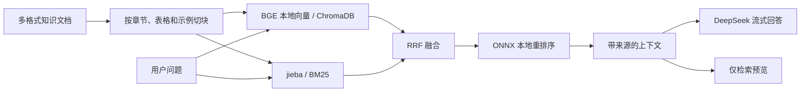

# 领星接口文档 RAG

基于领星 API 文档的检索增强问答工具。用自然语言查找接口、请求参数、返回字段和业务流程，回答附带来源文档，便于回到原文核对。

本地检索采用 **BGE 向量 + BM25 + RRF + ONNX 重排序**，回答生成使用 **DeepSeek API**。提供 Flask Web 页面、账户登录、游客模式、独立对话和 MySQL 历史记录。

[快速开始](#快速开始) · [部署说明](DEPLOYMENT.md) · [配置示例](config_local.example.py) · [第三方资料说明](THIRD_PARTY_NOTICES.md) · [MIT License](LICENSE)

## 功能

- **接口文档问答**：按业务分类提问，查看答案、检索片段及完整文档。
- **本地混合检索**：结合中文分词、参数名匹配和语义向量，再用本地模型重排序。
- **仅检索模式**：不调用 DeepSeek；未配置 API key 时也可查看检索结果。
- **增量索引**：复用未改变的向量，完成新索引后再切换活动版本。
- **自动同步文档**：定期检查 GitHub 文档源，记录版本和增删改，更新索引并在回答来源旁展示资料版本时间。
- **独立对话与记忆**：完整回答按用户和对话保存，提供滚动摘要。
- **会话工具**：停止生成、按标题和问答内容搜索、重命名、删除及完整 Markdown 导出。
- **游客模式**：使用临时对话，退出时删除该游客的记录，过期记录由后台清理。
- **点赞知识库**：明确点赞的问答才进入共享辅助知识库，接口原文具有更高优先级。

本项目提供文档检索与解释，不会替用户调用领星业务 API。

## 工作流程



## 快速开始

以下使用 Windows PowerShell。项目已在 Windows / Python 3.13 环境验证；需要 Python 3.11 或以上版本。

### 1. 获取代码与安装依赖

```powershell
git clone https://github.com/Brcors/lingxing-rag.git
cd lingxing-rag
python -m venv .venv
.\.venv\Scripts\python.exe -m pip install --upgrade pip

# 默认使用 CPU，先安装 CPU 版 PyTorch。
.\.venv\Scripts\python.exe -m pip install torch --index-url https://download.pytorch.org/whl/cpu
.\.venv\Scripts\python.exe -m pip install -r requirements.txt

Copy-Item config_local.example.py config_local.py
```

仓库包含程序、接口文档快照和空白配置示例，不包含 API key、数据库、账户与聊天记录、模型权重或虚拟环境。

### 2. 准备 MySQL

先安装并启动 MySQL，建议使用 8.4 LTS。Web 页面的登录、注册和游客模式均需要数据库。

在 MySQL 管理终端中创建数据库及专用账户，将密码占位符替换为自己的密码：

```sql
CREATE DATABASE IF NOT EXISTS lingxing_rag
    CHARACTER SET utf8mb4 COLLATE utf8mb4_unicode_ci;
CREATE USER 'lingxing_rag'@'127.0.0.1'
    IDENTIFIED BY 'CHANGE_ME_MYSQL_PASSWORD';
GRANT ALL PRIVILEGES ON lingxing_rag.*
    TO 'lingxing_rag'@'127.0.0.1';
```

应用首次访问账户功能时会自动创建所需数据表，无需手动导入表结构。更多说明见 [DEPLOYMENT.md](DEPLOYMENT.md)。

### 3. 填写本机配置

编辑刚复制的 `config_local.py`：

```python
DEEPSEEK_API_KEY = ""  # 填写自己的 key；留空时可使用仅检索模式。

MYSQL_HOST = "127.0.0.1"
MYSQL_PORT = 3306
MYSQL_USER = "lingxing_rag"
MYSQL_PASSWORD = ""  # 填写上一步设置的数据库密码。
MYSQL_DATABASE = "lingxing_rag"
```

`config_local.py` 已被 Git 忽略。通用检索参数在 [config.py](config.py)，本机文件可以覆盖同名参数。不要将真实凭证提交到仓库。

默认生成模型配置为 `deepseek-flash`，请求发往 [DeepSeek API](https://api-docs.deepseek.com/)。生成回答和对话摘要需要可用的 API key 及账户余额；向量计算和重排序均在本机运行。

### 4. 下载模型并建立索引

```powershell
.\.venv\Scripts\python.exe -X utf8 manage.py download-model
.\.venv\Scripts\python.exe -X utf8 manage.py download-reranker
.\.venv\Scripts\python.exe -X utf8 manage.py index
.\.venv\Scripts\python.exe -X utf8 manage.py check
```

默认下载的模型为：

- [BAAI/bge-small-zh-v1.5](https://huggingface.co/BAAI/bge-small-zh-v1.5)：中文向量模型，512 维，权重约 96 MB。
- [Xenova/bge-reranker-base](https://huggingface.co/Xenova/bge-reranker-base)：重排序模型，使用 ONNX INT8 权重，约 279 MB。

首次下载需要联网。完整缓存保存在 `models/` 并记录模型仓库与 revision，之后本地推理可离线运行。ChromaDB 嵌入式运行，向量数据保存在 `data/chroma/`，不需要另外启动向量数据库服务。

文档默认读取项目内的 `领星接口API文档/`。知识目录和 `knowledge/` 补充目录支持 Markdown、TXT、PDF、DOCX、XLSX、XLSM、XLS、CSV 和 TSV；Excel 工作表会连同表头与行内容转换为可检索文本。扫描版或文字稀少的 PDF 页面使用 PaddleOCR，需额外安装 `requirements-ocr.txt`；首次 OCR 会下载识别模型。GitHub 自动同步仍只同步上游 Markdown 文档和 `tasks.json`，其他格式可放入本机文档目录。

### 5. 启动和使用

```powershell
.\start.bat
```

浏览器打开 <http://127.0.0.1:5000>，注册账户或选择“以游客身份进入”，然后新建对话提问。也可以先选择“仅检索”检查文档命中情况。

例如：

- 查询货件列表需要哪些请求参数？
- `/erp/sc/data/fba_report/shipmentList` 使用什么请求方式？
- 创建 STA 任务需要哪些步骤？
- 查询利润报表-SKU 支持什么时间范围？

启动时会检查文档变动、复用已有索引并预热模型。重复启动会识别已运行的同一项目；端口被其他程序占用时，可执行 `start.bat --port 5001`。

停止服务使用 `stop.bat`；更换端口后使用 `stop.bat -Port 5001`。详细启动参数和数据库生命周期见 [部署说明](DEPLOYMENT.md)。

## 常用管理命令

```powershell
# 查看配置与索引状态，不显示 API key
.\.venv\Scripts\python.exe -X utf8 manage.py check

# 增量更新；--force 会重新计算全部向量
.\.venv\Scripts\python.exe -X utf8 manage.py index
.\.venv\Scripts\python.exe -X utf8 manage.py index --force

# 命令行检索，不调用生成 API
.\.venv\Scripts\python.exe -X utf8 manage.py search "如何查询 FBA 货件列表？"

# 不自动打开浏览器，并指定 Web 端口
.\start.bat --no-browser --port 5001
```

## 检索与会话设计

### 文档自动同步

默认从 `lpj2026/one2` 的 `main` 分支同步 `领星接口API文档/`，服务启动后按最近检查时间判断是否到期，并每小时检查。可在 `config_local.py` 中配置：

```python
DOC_SYNC_ENABLED = True
DOC_SYNC_INTERVAL_SECONDS = 3600  # 最小 60 秒
```

侧栏提供“检查更新”“同步文档”和版本变更记录；游客可查看版本，正式账户可以触发同步。也可使用：

```powershell
.\.venv\Scripts\python.exe -X utf8 manage.py check-docs
.\.venv\Scripts\python.exe -X utf8 manage.py sync-docs
```

“检查更新”只检查差异；“同步文档”按固定提交下载并校验文件，再增量更新索引。首次同步会建立版本基线并补齐索引中的来源时间，已有向量可以复用。检测到本地手动修改时会停止同步并提示冲突，避免覆盖修改。

来源旁显示的“资料版本时间”来自相关同步版本的上游提交时间，**不是官方文档发布日期**；“最近检查”表示本系统检查来源的时间。历史回答保留当时保存的来源，不会被当前版本时间覆盖。

版本记录与修改前文档备份保存在 `data/document-sync/`，版本列表保留最近 30 条。下载或校验失败时保留原文档；索引更新失败时继续使用上一代索引，并在后续同步重试。

### 对话管理与停止生成

左侧搜索框支持匹配当前账户或游客的对话标题、问题和回答。顶部可重命名、删除或导出当前对话；Markdown 导出包含完整已保存问答和来源，不受页面历史分页限制。

生成中点击“停止生成”，会发送后端取消请求并关闭上游响应。保存前被取消的回答不会进入历史、记忆或点赞知识库，已显示的片段可以复制。取消不会撤销已经完成的 API 调用。默认单进程 Waitress 支持此取消机制，多进程部署需要共享取消状态或将相关请求路由到同一进程。

删除对话会级联删除个人问答与摘要，已点赞的共享知识会保留。删除最后一条游客对话时会建立一条新的空白对话，以保留当前游客身份。

### 检索与记忆策略

**检索**：按标题层级、段落、表格行和代码块切分文档；向量与 BM25 各召回 20 条，RRF 融合后重排序，默认选取约 6 条证据。上下文补齐接口及章节信息，证据数量可能受去重和长度预算影响。重排序失败时回退混合检索，并在页面提示。

**规则分流与一次补查**：保留已有的指代补全、别名扩展和流程问题拆解，再用本地规则区分接口、请求参数、返回字段、流程和版本问题。首次检索检查指定路径、字段、章节等证据；匹配时直接回答，有缺口才用本地规则追加一条查询，最多补查一次。两轮证据按同一上下文预算合并、去重并重新编号；仍有缺口时提示补充信息。

分流、证据检查和补查均不调用规划模型。生成模式下，原有 `QUERY_DECOMPOSITION_*` 仍控制流程问题拆解（最多 3 条子问题，并与原问题融合检索）；补查不会重复拆解。普通问题、仅检索模式及未配置 key 时不调用拆解模型。规则不能识别所有语义缺口，回答需结合引用核对。

**上下文追问**：“刊登怎么做”之后的“需要哪些参数”“有哪些必填项”等省略主语问题，会携带前文业务对象进行检索；明确切换到其他业务时不沿用旧主题。如果上文是多接口流程且尚未选定接口，先返回带来源的候选接口供用户确认，不拼接不同接口的参数。澄清会保存到个人对话，不提供共享点赞入口。用户明确接口后，再检索其参数章节。刊登商品属性可能依赖站点和 productType 的 JSON Schema，当前服务没有自动调用业务 API 获取实时 Schema，静态文档与示例不能证明所有类目的完整必填属性。

版本问题只读 `data/document-sync/` 中已保存的记录。整体仓库版本与具体接口更新时间分别标明；记录只有文件级增删改，不能证明字段级变化或官方最新版本。版本回答不会进入共享点赞问答库。页面显示检索类型、轮数及待确认接口状态。

```python
RETRIEVAL_RETRY_ENABLED = True  # False 表示只用首轮结果
```

旧的 `REACT_*` 配置已移除。当前实现为已有检索流程的规则补充，不提供自主工具规划循环。

**个人记忆**：完整问答写入 MySQL。每个对话首次积累 5 组完整问答后生成摘要，之后每新增 4 组更新一次。原始问答保留，摘要仅提供对话背景，接口事实以本轮检索资料为准。

**整次请求预算**：回答发送前统一检查系统提示、当前问题、历史问答、摘要、检索资料、预留回答及安全余量。超过预算时依次移除最早的完整问答、按完整句子精简摘要、移除低优先级的整份证据片段；当前问题、追问的业务对象线索和系统规则保持完整，来源列表随证据同步更新。不会为精简额外调用模型；必要证据仍放不下时提示指定接口、字段或步骤。原始对话与摘要不被修改。

默认本地总预算 `LLM_CONTEXT_WINDOW=32768`、安全余量 `LLM_CONTEXT_SAFETY_MARGIN=1024`，回答空间按 `DEEPSEEK_MAX_TOKENS` 预留；这是一项保守的本地容量限制，不代表模型官方上下文大小。采用 UTF-8 字节及消息开销保守估算，统计值不是实际分词或计费 token。所有模型请求（含问题拆解和后台摘要）在 API 发送前再检查一次；摘要超限时保留原始问答并报告整理失败。仅当回答尚未输出且服务端明确返回上下文超限时，进一步精简并最多重试一次；其他错误及已输出部分回答不会触发该重试。[DeepSeek 对输入与输出总长度的说明](https://api-docs.deepseek.com/api/create-chat-completion/)。

**共享知识**：个人历史按账户隔离。只有用户明确点赞的问答会进入共享辅助知识库，每次最多补充 1 条；当前接口文档优先于历史问答。

**游客记录**：游客使用独立临时会话；退出游客或转为正式账户时清除该游客的临时记录。关闭浏览器不会立即删除记录，服务会清理超过 24 小时未活动的游客数据。

## HTTP API

- `GET /api/status`：公开健康检查，返回索引与模型状态。
- `POST /api/auth/register`、`POST /api/auth/login`、`POST /api/auth/guest`：注册、登录或进入游客模式。
- `GET /api/conversations`、`POST /api/conversations`：列出或创建独立对话。
- `GET /api/conversations?q=关键词`：搜索自己的对话及问答内容。
- `PATCH /api/conversations/<id>`：提交 `{"title":"新名称"}` 重命名；`DELETE` 同一路径删除对话。
- `GET /api/conversations/<id>/export`：下载完整 Markdown。
- `POST /api/conversations/<id>/cancel`：提交对应流式提问的 `request_id` 停止生成。
- `GET /api/documents/versions`：读取资料版本、更新时间与变更。
- `POST /api/documents/sync`：提交 `{"check_only":true}` 检查，或 `{"check_only":false}` 同步并更新索引。
- `POST /api/ask`：一次性返回答案、来源和耗时。
- `POST /api/ask/stream`：以 NDJSON 返回状态、来源、文本片段及完成事件。
- `POST /api/feedback`：点赞自己的已保存问答；游客不可写入共享知识库。
- `POST /api/index`：后台更新文档索引，需要正式账户。
- `GET /documents/<document_id>`：查看完整来源文档。

除公开健康检查及登录入口外，业务接口需要登录会话。所有修改请求还需携带页面 `meta[name="csrf-token"]` 中的值，放入 `X-CSRF-Token` 请求头。

提问请求示例：

```json
{
  "question": "查询货件列表需要哪些请求参数？",
  "category": "FBA",
  "mode": "answer",
  "conversation_id": "创建对话后返回的 ID",
  "request_id": "8cf15d0e-a7c4-4b31-8bdd-10bc52ff8bec"
}
```

`category` 可省略；`mode` 可设为 `retrieve`。个人上下文由服务器按账户和对话读取，不接受浏览器传入的历史记录作为个人上下文。

## 项目结构

```text
app/                       Flask 页面、认证与 HTTP API
rag/ingestion/             多格式文档解析与语义切块
rag/indexing/              ChromaDB、增量索引与版本切换
rag/retrieval/             BM25、向量融合与本地重排序
rag/generation/            DeepSeek 客户端、提示词与问题拆解
rag/accounts/              账户、独立对话、游客与记忆
rag/knowledge/             点赞问答持久化与辅助检索
knowledge/                 带来源的接入更新说明
领星接口API文档/           第三方接口文档快照
config.py                  通用配置
config_local.example.py    不含真实凭证的本机配置示例
manage.py                  模型下载、索引和检索命令
run.py                     Waitress 服务入口
```

`data/`、`models/`、`runtime/`、`.venv/` 和 `config_local.py` 只保存在本机，不提交到 Git。

## 开发与验证

```powershell
.\.venv\Scripts\python.exe -m pip install -r requirements-dev.txt

# 不依赖 MySQL 的测试
.\.venv\Scripts\python.exe -m pytest -q tests --ignore=tests/test_accounts_memory.py --ignore=tests/test_guests.py

# 完整测试；需使用具备临时建库、删库权限的测试数据库账户
.\.venv\Scripts\python.exe -m pytest -q tests

# 真实本地模型的固定检索案例，需先下载模型并建立索引
.\.venv\Scripts\python.exe -X utf8 evaluate.py
```

账户和游客集成测试使用随机命名的临时 MySQL 数据库，结束时删除测试库；模型响应使用替身，不请求付费生成接口。应用专用账户通常只有自身数据库权限，运行完整测试前请单独准备测试账户。

`evaluate.py` 检查 8 个固定案例，结果写入 `data/retrieval-evaluation.json`；这组案例不能代表总体准确率。欢迎通过 [Issues](https://github.com/Brcors/lingxing-rag/issues) 提交问题，或用 Pull Request 改进检索、测试和文档。

## 文档来源与许可证

本项目为独立开发的文档问答工具，不是领星官方产品。接口文档来自 [lpj2026/one2](https://github.com/lpj2026/one2/tree/ae142f1b0b33a8ac834c1e7c27482ff9badbcd02/领星接口API文档) 的固定快照；文档可能滞后于接口更新，调用前请核对 [领星官方 API 文档](https://apidoc.lingxing.com/)。

本项目原创程序代码及原创说明采用 [MIT License](LICENSE)。第三方接口文档、模型、依赖及商标不因本项目开源而改变其原有权利或许可，详见 [THIRD_PARTY_NOTICES.md](THIRD_PARTY_NOTICES.md)。
